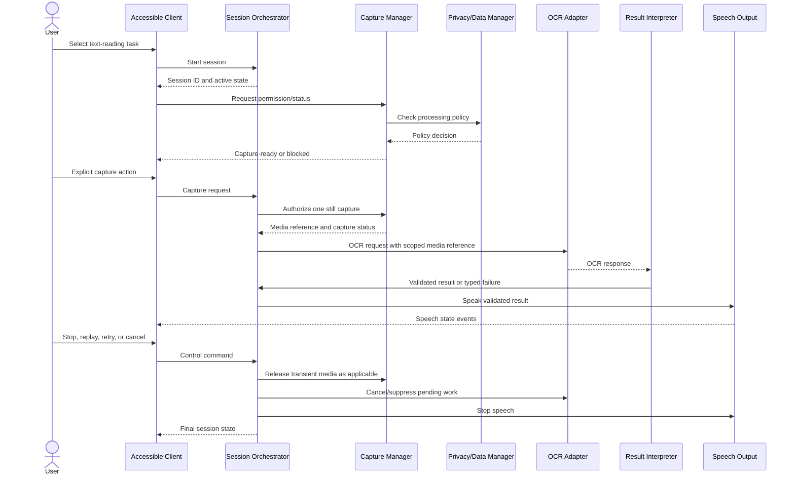

# MVP Text-Reading Interface Specification

| Attribute | Value |
|---|---|
| Project | AI Guardian for Blind People |
| Document ID | ICD-MVP-001 |
| Version | 0.1 |
| Status | Proposed logical contract — review and platform feasibility pending |
| Document Type | MVP Interface Specification |
| Related | MVP-001, UC-001, SRS-001, RTM-001, SYS-ARCH-001, ICD-001, SEC-001, SAF-001, ACC-001, DATA-001, VVP-001 |
| Prepared | 06 November 2026 |

## 1. Purpose and authority

This document refines the logical interfaces required by the proposed MVP-1 workflow: user-initiated smartphone still-image text reading. It defines component responsibilities, logical message content, lifecycle semantics, error categories, and verification expectations.

This document supplements ICD-001. It does not replace the system-wide interface inventory, approve a transport, select an OCR engine, define production wire formats, or authorize implementation. Exact field names, serialization, media representation, payload limits, timeout values, and platform APIs remain subject to technical design and evidence.

## 2. MVP interface boundary

The MVP-1 logical path is:

1. Accessible Client (UI) receives a user request.
2. Session Orchestrator (ORCH) creates and owns the reading session.
3. Capture Manager (CAP) checks permission and obtains one user-authorized still image.
4. Privacy/Data Manager (DATA) authorizes the data operation and governs transient media handling.
5. Perception Adapter (AI) invokes the selected OCR capability.
6. Result Interpreter (RES) validates response identity, schema, freshness, status, and content.
7. Speech Output (TTS) presents recognized text or a bounded failure message.
8. ORCH closes or cancels the session; DATA applies the approved disposal policy; DIAG records permitted non-sensitive diagnostics.

No remote service is assumed. The OCR adapter may later wrap an on-device or remote engine, but any remote route requires a separate privacy, security, latency, cost, and provider-retention assessment.

## 3. Contract-wide rules

- Every operation belongs to one unique session and one request/correlation identifier.
- Every message carries a contract/schema version.
- The producer and consumer validate message type, required fields, size, state, and authorization before acting.
- A response is accepted only if its session and request identifiers match the active request and it has not expired, been cancelled, or been superseded.
- Duplicate requests must not create duplicate capture or speech actions. Operations should be idempotent where possible; otherwise duplicate detection is mandatory.
- User cancellation takes precedence over a late OCR response.
- OCR text is untrusted content. It must never overwrite trusted permission, capture, session, or system-error state.
- OCR output must not be described as guaranteed accurate. Quality metadata is optional and must not be fabricated when the engine does not supply it.
- Raw images, recognized text, and personal data must not be written to routine diagnostic logs.
- No continuous capture, background camera operation, or microphone activation is part of MVP-1.
- The application must not infer that an area, route, crossing, or physical environment is safe.

## 4. Session lifecycle contract

### 4.1 Session identity

ORCH creates a session identifier when a supported text-reading task is accepted. The identifier is opaque and unique within the application's defined scope. Each capture/OCR attempt receives a separate request identifier linked to that session.

Logical session metadata:

| Field | Required | Meaning |
|---|---:|---|
| session_id | Yes | Identifier for the user-visible reading session |
| request_id | Per operation | Identifier for a capture or OCR operation |
| contract_version | Yes | Version of the logical message contract |
| task_type | Yes | Fixed supported task identifier for text reading |
| created_at | Yes | Creation timestamp from the trusted application clock |
| expires_at | Where needed | Expiry boundary for rejecting delayed results |
| session_state | Yes | Current ORCH-owned lifecycle state |

Identifiers must not contain names, phone numbers, or other directly identifying information.

### 4.2 Allowed lifecycle

| State | Meaning | Permitted next states |
|---|---|---|
| READY | No active reading session | SESSION_ACTIVE, CLOSED |
| SESSION_ACTIVE | User has entered the reading task | PERMISSION_PENDING, CAPTURE_READY, CANCELLING, CLOSED |
| PERMISSION_PENDING | OS permission decision is outstanding | CAPTURE_READY, BLOCKED, CANCELLING |
| CAPTURE_READY | Permission and capture prerequisites are satisfied | CAPTURING, CANCELLING, CLOSED |
| CAPTURING | One user-authorized still capture is in progress | PROCESSING, RECOVERABLE_FAILURE, CANCELLING |
| PROCESSING | OCR request is active | RESULT_READY, RECOVERABLE_FAILURE, CANCELLING |
| RESULT_READY | A validated result is available | SPEAKING, CAPTURE_READY, CANCELLING, CLOSED |
| SPEAKING | TTS is presenting the validated result | RESULT_READY, CAPTURE_READY, CANCELLING, CLOSED |
| RECOVERABLE_FAILURE | A specific failure has a valid recovery action | CAPTURE_READY, PROCESSING, CANCELLING, CLOSED |
| BLOCKED | Task cannot proceed until a blocking condition changes | SESSION_ACTIVE, CANCELLING, CLOSED |
| CANCELLING | Cancellation is being propagated | CLOSED |
| CLOSED | Session is terminal | READY |

The implementation must define state-transition guards and ensure a terminal session cannot be reopened by a delayed callback. The table is a proposed MVP subset of the broader state model in UC-001.

## 5. Capture interface

### 5.1 Request

CAP accepts a capture request only when:
- A current session exists.
- The user has explicitly activated capture for that session.
- Camera permission is granted.
- The camera is available and not in a conflicting state.
- The privacy policy permits the requested processing.
- The session is not cancelling or closed.

Logical capture request:

| Field | Required | Description |
|---|---:|---|
| session_id | Yes | Active session |
| request_id | Yes | Unique capture operation |
| contract_version | Yes | Contract version |
| capture_mode | Yes | Must identify a single still image |
| user_action_confirmed | Yes | Trusted application state confirming explicit action |
| purpose | Yes | Text-reading task purpose |
| processing_policy_ref | Yes | Applicable consent/privacy policy reference |

The user-action flag must be derived from trusted application interaction state, not accepted from untrusted OCR or external payload content.

### 5.2 Response

Capture result status shall distinguish at least:
- CAPTURED
- PERMISSION_DENIED
- PERMISSION_RESTRICTED
- CAMERA_UNAVAILABLE
- CAPTURE_FAILED
- CANCELLED
- REJECTED_INVALID_STATE

A successful capture response contains a short-lived media reference or platform-managed image handle, capture metadata required for processing, and the matching session/request identifiers. It must not expose an arbitrary filesystem path to unrelated components.

The capture response must not claim image quality unless a defined quality assessment has actually run. If an image-quality assessment is added, its algorithm, supported conditions, and limitations must be documented separately.

### 5.3 Capture disposal

The media reference is valid only for the defined processing lifecycle. On cancellation, terminal failure, or session closure, CAP and DATA must release temporary references and request deletion of transient copies under their control. Any OS-managed cache, backup, crash dump, or third-party retention limitation must be assessed and disclosed; the system must not promise deletion it cannot verify.

## 6. OCR interface

### 6.1 Request

AI accepts an OCR request only from ORCH/CAP after authorization and capture completion.

| Field | Required | Description |
|---|---:|---|
| session_id | Yes | Active session |
| request_id | Yes | Unique OCR operation |
| contract_version | Yes | Contract version |
| task_type | Yes | TEXT_RECOGNITION |
| media_reference | Yes | Authorized short-lived captured image handle |
| language_hint | Optional | User-selected or configured language hint, if supported |
| orientation_hint | Optional | Known orientation metadata, if available |
| processing_policy_ref | Yes | Applicable privacy/processing policy |
| requested_output | Yes | Recognized text and supported metadata only |

The adapter must not receive unrelated user profile data, location, contacts, or historical media. Language support is not assumed; unsupported or unknown language handling must be explicit.

### 6.2 Response

| Field | Required | Description |
|---|---:|---|
| session_id | Yes | Must match request |
| request_id | Yes | Must match request |
| contract_version | Yes | Contract version |
| status | Yes | SUCCESS, PARTIAL, NO_TEXT, UNSUPPORTED, UNAVAILABLE, FAILED, CANCELLED |
| recognized_text | Conditional | Present only when text was recognized |
| text_blocks | Optional | Ordered text segments where supported |
| reading_order | Optional | Explicit order or an indication that order is unavailable |
| quality_metadata | Optional | Engine-produced, documented quality information |
| language_detected | Optional | Only when the engine supports it |
| engine_id/version | Where available | Reproducibility and evaluation metadata |
| completed_at | Yes | Completion timestamp |
| warning_codes | Optional | Known limitations or partial-result markers |

A response with no recognized text is not a successful empty reading. It must carry NO_TEXT or another explicit status. A partial response must be identified as partial. Unknown confidence values must remain unknown; no confidence threshold is established by this document.

### 6.3 Text interpretation

- Preserve text content as returned, subject to safe display and speech handling.
- Preserve text block ordering when the OCR engine supplies it.
- Do not invent missing words, punctuation, or reading order.
- Do not silently remove content that could materially change meaning.
- If layout/reading order is ambiguous, disclose the limitation where the ambiguity affects usability.
- The initial supported language(s), script(s), and evaluation conditions must be approved before release.

## 7. Result validation and speech interface

### 7.1 Result acceptance

RES validates:
1. Schema and contract version.
2. Session/request identity.
3. Session state and cancellation status.
4. Response freshness and expiry.
5. Status/content consistency.
6. Presence and provenance of optional quality metadata.
7. Task scope and prohibited safety claims.

Only validated results may move to RESULT_READY. Invalid or stale results are rejected and reported through a safe error path.

### 7.2 Speech command model

| Command | Preconditions | Expected behavior |
|---|---|---|
| SPEAK_RESULT | Valid result available | TTS speaks the recognized text or an approved status message |
| STOP_SPEECH | Speech active | TTS interrupts current speech and acknowledges stop |
| REPLAY_RESULT | Valid result retained in current session | TTS starts the same validated text again without recapture |
| CANCEL_SESSION | Session active | ORCH cancels pending work, stops speech, and closes safely |
| RETRY_CAPTURE | Session permits retry | Returns to capture-ready state; requires a new explicit user action |

TTS completion, interruption, and failure events must include the session identifier and speech-operation identifier. A callback from an earlier speech operation must not alter the current state.

Speech rate and verbosity are exposed only if supported by the selected platform and validated for accessibility. MVP-1 does not require voice-command input.

## 8. Cancellation, timeout, and late response handling

- Cancellation is accepted from every non-terminal active state.
- ORCH marks the session CANCELLING before propagating cancellation to CAP, AI, and TTS.
- Components acknowledge cancellation when they can stop work; where physical cancellation is impossible, they must still suppress the result.
- A late response for a cancelled, expired, superseded, or closed request is discarded and must not be spoken.
- A retry creates a new request identifier. It must not reuse the cancelled request identifier.
- Timeout values are TBD and must be established from platform and OCR benchmarks. Timeout must lead to a defined failure state, not an indefinite spinner or silent wait.
- If a timeout occurs while a remote provider is processing, the privacy and deletion implications of provider-side work must be addressed contractually and technically.

## 9. Error taxonomy and recovery mapping

| Error code | Meaning | User-facing recovery |
|---|---|---|
| PERMISSION_DENIED | Camera permission denied | Explain how to grant permission or exit; do not repeatedly prompt |
| PERMISSION_RESTRICTED | OS/device policy prevents camera access | Explain restriction; offer exit |
| CAMERA_UNAVAILABLE | Camera missing, busy, or unavailable | Retry only when availability may have changed |
| CAPTURE_FAILED | Still-image capture failed | Offer a new capture attempt |
| INVALID_IMAGE | Input cannot be processed as an image | Retry capture |
| IMAGE_QUALITY_UNSUPPORTED | Input conditions are outside supported quality | Explain limitation and offer recapture |
| OCR_NO_TEXT | No text was detected | Explain no text was recognized; offer recapture |
| OCR_LANGUAGE_UNSUPPORTED | Selected/detected language is unsupported | Explain supported-language limitation |
| OCR_UNAVAILABLE | OCR engine/service unavailable | Offer retry later or close |
| OCR_TIMEOUT | OCR did not complete within approved limit | Offer retry; suppress late result |
| OCR_MALFORMED_RESPONSE | Response violates contract | Fail safely; log non-sensitive code |
| STALE_RESPONSE | Response belongs to expired/superseded request | Discard; do not announce as current |
| SESSION_CANCELLED | User cancelled | Stop processing/speech and close |
| SPEECH_UNAVAILABLE | TTS unavailable or failed | Announce through an available accessible fallback if one exists; otherwise fail accessibly |
| INTERNAL_ERROR | Unexpected internal failure | Provide safe generic message and retry/close where appropriate |

The error code must be stable and separate from localized user-facing wording. Error messages must not expose stack traces, credentials, internal file paths, provider secrets, or sensitive media.

## 10. Privacy and security requirements at the boundary

- Enforce least-privilege access to camera and transient media.
- Explain camera use before permission request.
- Capture only after explicit user action.
- Use local processing by default only if the selected OCR engine supports it and feasibility confirms it; otherwise obtain explicit disclosure/consent for remote processing before enabling it.
- Do not transmit media to an external service without a documented processor assessment, approved data flow, transport protection, retention terms, and user-facing disclosure.
- Do not store raw media or recognized text in diagnostic logs.
- Keep temporary media references scoped to the active session and invalidate them at closure.
- Protect service credentials outside user-visible content and logs.
- Validate all external responses as untrusted input.
- Maintain a data-flow and deletion verification record for each processing route.

## 11. Sequence overview

This diagram is logical and does not prescribe thread, process, IPC, network, or platform implementation.

## 12. Contract verification scenarios

| Scenario ID | Scenario | Expected contract behavior | Related planned tests |
|---|---|---|---|
| IF-MVP-001 | Permission denied | No capture/OCR request; accessible denial state | TC-FR-007, TC-FR-008 |
| IF-MVP-002 | Capture requested without user action | Request rejected | TC-FR-009 |
| IF-MVP-003 | Valid capture and OCR response | Matching response accepted and text made available | TC-FR-010, TC-FR-011 |
| IF-MVP-004 | Response has wrong session/request ID | Response rejected; no speech | TC-FR-018 |
| IF-MVP-005 | OCR returns no text | NO_TEXT status; no invented content | TC-FR-010, TC-FR-019 |
| IF-MVP-006 | OCR returns partial text | Partial status and limitation communicated | TC-FR-010, TC-FR-019 |
| IF-MVP-007 | User cancels during capture | Capture stopped where possible; session closes safely | TC-FR-004 |
| IF-MVP-008 | User cancels during OCR | Work cancelled/suppressed; late result discarded | TC-FR-004, TC-FR-018 |
| IF-MVP-009 | User cancels during speech | Speech stops and session state remains consistent | TC-FR-005, TC-FR-004 |
| IF-MVP-010 | OCR timeout followed by late success | Late response discarded | TC-FR-016, TC-FR-018 |
| IF-MVP-011 | Duplicate retry command | No duplicate active capture or speech operation | TC-FR-017 |
| IF-MVP-012 | Malformed OCR response | Typed failure; no malformed text spoken | TC-FR-016, TC-FR-018 |
| IF-MVP-013 | Image reference used after session closure | Access denied or reference invalidated | TC-FR-022, TC-NFR-006 |
| IF-MVP-014 | Diagnostic log inspected | No raw image, recognized text, credentials, or unnecessary personal data | TC-FR-028, TC-NFR-007 |

These are planned scenarios, not executed tests. Detailed procedures, fixtures, test data, expected results, and evidence records remain part of VVP-001 test design.

## 13. Open contract decisions

The following remain deliberately unresolved:
- Mobile framework and target OS/API baseline.
- OCR engine, supported language/script set, and processing location.
- Exact image handle/media representation and lifecycle APIs.
- Message serialization and internal component communication mechanism.
- Whether any remote OCR route is permitted.
- Timeout, retry, payload, memory, and latency budgets.
- OCR quality metadata semantics and release thresholds.
- Localization and speech service behavior.
- Storage/cache behavior and deletion guarantees.
- Supported accessibility service/device test matrix.

Each decision requires evidence and, where architecturally significant, an ADR entry.

## 14. Version history

| Version | Date | Change |
|---|---|---|
| 0.1 | 2026-11-06 | Initial MVP-specific logical interface contract, lifecycle, capture/OCR/speech semantics, error taxonomy, cancellation rules, privacy boundaries, and planned contract scenarios. |
